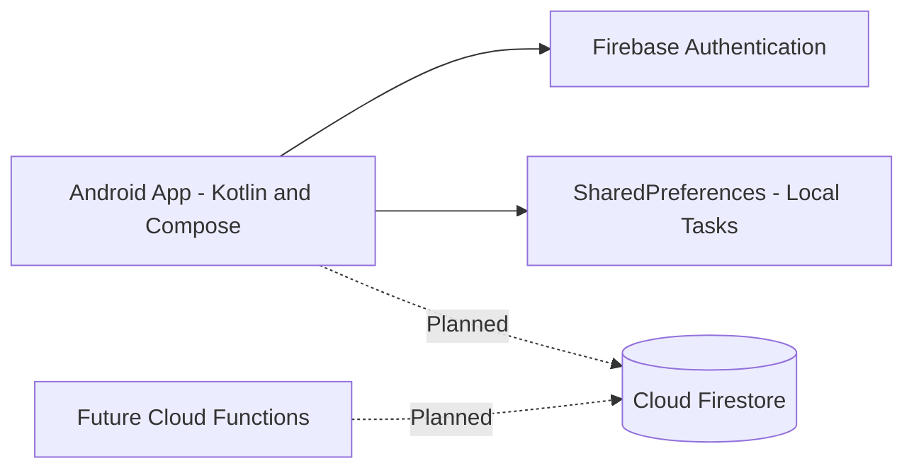

# StudyTrack – Student Task Manager

## Project Overview

StudyTrack is an Android application designed to help university students manage academic assignments, track deadlines and monitor task completion.

The application is developed using Kotlin, Jetpack Compose and Firebase Authentication.

## Problem Statement

University students often struggle to organise assignments and monitor deadlines. StudyTrack provides a simple mobile interface for managing academic tasks.

## Project Team

Individual project.

Roles:
- Product Owner
- Tech Lead
- Android Developer
- QA / DevOps

All roles are fulfilled by the individual student.

## MVP Features

### Sprint 1
- User registration with Firebase Authentication
- User login and logout
- Automatic login for authenticated users
- Student task dashboard

### Additional Implemented Features
- Add assignments
- Assign deadlines
- Mark tasks as completed
- Display task completion progress
- Save tasks locally using SharedPreferences
- Share assignments through Android Intents

### Planned for Later Sprints
- Cloud Firestore task synchronization
- Task editing and deletion
- Teacher assignment management
- Server-side notifications

## Technology Stack

- Kotlin
- Jetpack Compose
- Firebase Authentication
- Android Studio
- SharedPreferences
- Git and GitHub

## Data Model

### Current Local Task Model

StudentTask:
- title: String
- completed: Boolean
- deadline: String

### Proposed Cloud Firestore Collections

users:
- uid: String
- email: String
- displayName: String
- createdAt: Timestamp

tasks:
- title: String
- deadline: Timestamp
- completed: Boolean
- ownerId: String
- createdAt: Timestamp

## Architecture



## How to Run

1. Clone the repository.
2. Open the project using Android Studio.
3. Wait for Gradle synchronization.
4. Verify the Firebase configuration file is in the app folder.
5. Run the application on an Android emulator or physical device.
6. Register a new account or log in using Firebase Authentication.
7. Create and manage student tasks.

## Testing

The following features were manually tested on an Android emulator:

- Application launch
- Firebase registration
- Firebase login
- Logout
- Automatic login
- Task creation
- Task completion tracking
- Local task storage
- Assignment deadline display
- Android sharing Intent

## Future Improvements

- Cloud Firestore integration
- Separate tasks for each authenticated user
- Task editing and deletion
- Improved authentication architecture
- Teacher role and assignment assessment
- Server-side notifications


---

## Lab 2 — Cloud Data, CRUD and Server-Side Access Control

**Application:** StudyTrack student task manager
**Course:** Team Project — Mobile Application in the Cloud
**Lab:** 2 — Cloud Data: CRUD and Server-Side Access Control
**Implementation:** Kotlin/Jetpack Compose + Firebase

### Technology stack

| Layer | Technology |
| --- | --- |
| Mobile application | Kotlin, Jetpack Compose, Android |
| Authentication / session | Firebase Authentication (email/password) |
| Cloud backend and database | Cloud Firestore (default database) |
| Cloud region | Warsaw, Poland (`europe-central2`) |
| Data access | `TaskRepository` interface and `FirestoreTaskRepository` implementation |
| Screen state | `TaskListViewModel` and `TaskEditViewModel` |
| Validation / search / statistics | Pure Kotlin functions (`TaskValidator`, `TaskListLogic`) |
| Tests | Firebase Emulator Suite, `@firebase/rules-unit-testing`, Android emulator |
| Version control | Git / GitHub branches, issues and pull requests |

### Definition of Done

A requirement is done when its acceptance criteria are met; it runs on a test device without crashing on invalid input; backend access is protected by deployed server-side rules; required tests and screenshots are recorded; and its associated GitHub issue is closed by a reviewed pull request merged to `main`. This is the *team standard*, not a claim that every GitHub review has already occurred.

### Firestore data model

| Collection | Field | Data type | Set by |
| --- | --- | --- | --- |
| `tasks` | document ID | String | Firestore (auto ID) |
| `tasks` | `ownerId` | String (Firebase UID) | App repository from authenticated session, enforced by rules |
| `tasks` | `title` | String | User; validated on client and server |
| `tasks` | `description` | String | User; validated on client and server |
| `tasks` | `categoryId` | String | App from selected `categories` document |
| `tasks` | `categoryName` | String | App from selected reference document; verified by rules |
| `tasks` | `deadline` | Firestore Timestamp | App from native date picker |
| `tasks` | `priority` | Integer (1–3) | User |
| `tasks` | `completed` | Boolean | App; initially `false` |
| `tasks` | `createdAt` | Firestore Timestamp | Server timestamp at creation |
| `tasks` | `updatedAt` | Firestore Timestamp | Server timestamp at creation and update |
| `categories` | document ID | String | Administrator in Firebase Console |
| `categories` | `name` | String | Administrator |
| `categories` | `description` | String | Administrator |
| `categories` | `sortOrder` | Integer | Administrator |

**Reference category documents:** `assignment` (Assignment, 1), `exam` (Exam Preparation, 2), and `group_project` (Group Project, 3). Signed-in users may read categories but cannot write them through the app. The Firestore console administrator enters reference data.

### Architecture

```text
Login / Register (Lab 1: AuthViewModel)
    -> StudyTrackLab2Home
        -> TaskList / TaskForm (Jetpack Compose UI)
            -> TaskListViewModel / TaskEditViewModel
                -> TaskRepository interface
                    -> FirestoreTaskRepository
                        -> Firebase Authentication + Cloud Firestore

TaskValidator (pure Kotlin) -> checks form input before writes
TaskListLogic (pure Kotlin) -> search and pending/completed counts
```

The UI does not issue Firestore requests directly. The repository uses a `whereEqualTo("ownerId", uid)` query and a realtime snapshot listener; the listener is removed when the list screen closes. A single form creates a new record or updates an existing one. Only the owner can read, update or delete their task. On update, `ownerId` and `createdAt` remain unchanged.

### Validation rules

- Task title contains 3–100 characters.
- Description is at most 200 characters.
- A category must be selected from the server-loaded reference list.
- A deadline must be chosen.
- Priority is an integer from 1 to 3.
- **Cross-field rule:** priority 3 requires a description of at least 10 characters.

Client-side validation prevents invalid form submissions; server-side rules independently validate each write. `firestore.rules` is committed as source-controlled security policy.

### CRUD and extensions

- **R5 (Read):** Owner-filtered realtime list with loading, error, empty and logout states.
- **R6 (Create/Update):** Shared task form, category selection, native date picker, field errors, disabled Save while saving, server timestamps.
- **R7 (Delete):** Named confirmation dialog, Cancel, confirmation message, live-list update.
- **R8 (Authorization):** Firestore rules enforce per-user ownership, immutable owner and creation time, required types/fields and category read-only policy.
- **E1 (Search):** Case-insensitive search across title and description, plus Clear.
- **E3 (Empty/no-results):** Distinct messages for no tasks and no search matches.
- **E7 (Statistics):** Pending and completed task counts.

### Security tests (R8)

The eight required scenarios are automated in `security-tests/tests/r8.test.cjs`. Tests run against the local Firestore emulator using mock user A, mock user B and an unauthenticated client. The test kit reported **8/8 PASS (0 FAIL)** on November 24, 2026. This is emulator evidence, **not** proof that the deployed rules were retested; confirm the local `firestore.rules` matches the published version.

Run from repository root after installing Firebase CLI and test dependencies:

```powershell
npm.cmd install --prefix .\security-tests
firebase.cmd emulators:exec --only firestore --project demo-studytrack-lab2 "npm.cmd --prefix security-tests test"
```

The real run output and rule SHA-256 are saved in [`docs/R8_RESULTS.md`](docs/R8_RESULTS.md). The test project ID begins with `demo-` to prevent production changes.

### Lab 2 evidence and GitHub process

Screenshots must be taken from the working Android emulator and Firebase Console. Evidence covers list/realtime behavior, create/edit (including timestamps), delete confirmation, E1/E3/E7 extensions, and user isolation. GitHub Sprint 2 issues, individual extension issues, reviewed pull requests, `Retro – Lab 2`, `Lab 2 – submission`, instructor assignment and the final `lab2` tag must be completed and linked in the submission issue. Do not mark these GitHub process items complete until verified.
