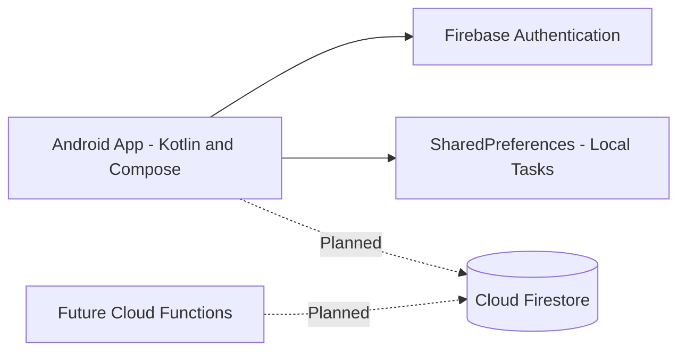

# StudyTrack – Student Task Manager

## Project Overview

StudyTrack is an Android application designed to help university students manage academic assignments, track deadlines and monitor task completion.

The application is developed using Kotlin, Jetpack Compose and Firebase Authentication.

## Problem Statement

University students often struggle to organise assignments and monitor deadlines. StudyTrack provides a simple mobile interface for managing academic tasks.

## Project Team

Individual project.

Roles:
- Product Owner
- Tech Lead
- Android Developer
- QA / DevOps

All roles are fulfilled by the individual student.

## MVP Features

### Sprint 1
- User registration with Firebase Authentication
- User login and logout
- Automatic login for authenticated users
- Student task dashboard

### Additional Implemented Features
- Add assignments
- Assign deadlines
- Mark tasks as completed
- Display task completion progress
- Save tasks locally using SharedPreferences
- Share assignments through Android Intents

### Planned for Later Sprints
- Cloud Firestore task synchronization
- Task editing and deletion
- Teacher assignment management
- Server-side notifications

## Technology Stack

- Kotlin
- Jetpack Compose
- Firebase Authentication
- Android Studio
- SharedPreferences
- Git and GitHub

## Data Model

### Current Local Task Model

StudentTask:
- title: String
- completed: Boolean
- deadline: String

### Proposed Cloud Firestore Collections

users:
- uid: String
- email: String
- displayName: String
- createdAt: Timestamp

tasks:
- title: String
- deadline: Timestamp
- completed: Boolean
- ownerId: String
- createdAt: Timestamp

## Architecture

## How to Run

1. Clone the repository.
2. Open the project using Android Studio.
3. Wait for Gradle synchronization.
4. Verify the Firebase configuration file is in the app folder.
5. Run the application on an Android emulator or physical device.
6. Register a new account or log in using Firebase Authentication.
7. Create and manage student tasks.

## Testing

The following features were manually tested on an Android emulator:

- Application launch
- Firebase registration
- Firebase login
- Logout
- Automatic login
- Task creation
- Task completion tracking
- Local task storage
- Assignment deadline display
- Android sharing Intent

## Future Improvements

- Cloud Firestore integration
- Separate tasks for each authenticated user
- Task editing and deletion
- Improved authentication architecture
- Teacher role and assignment assessment
- Server-side notifications
